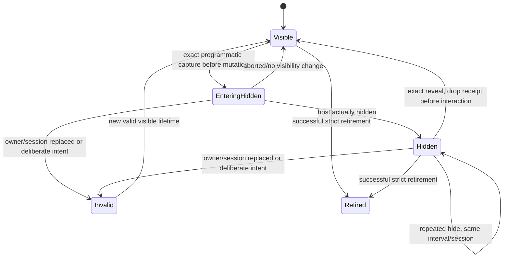

# ADR-0048: Owner-scoped programmatic background visibility

**Date:** 2026-10-15
**Status:** Proposed; coordinator acceptance required before production implementation.
**Traceability:** Task c65cbc91-82c3-4256-8789-4f39e915b8e8, parent 5ebcf1f8-5fab-421f-8ab8-1989300588b7, Solution ac76d20b-1183-4698-af07-21e3d0560dfe. Follows accepted ADR-0038/0040/0045; preserves ADR-0046 and ADR-0047.

## Context and evidence

A programmatic pane activation with `focus:false` currently hides the outgoing Markdown host. Chromium can blur its focused embedded Base input. The ordinary Table blur handler then saves draft `9` over provider `2` and removes the input. Accepted ADR-0045 permits the browser blur but requires the same connected draft/input/native root/parent and unchanged provider bytes. Trusted deliberate focus transfer continues ordinary blur-save.

Inspected actual final A `830427ff6bf0b9348fc9d2756f2aa32a76a0dda7` Workspace, MarkdownView, BaseView, TableView, CanvasView and RenderScope. Inspected B composition source-owner chain and accepted ADR-0045 in `.worktrees/overnight-native-combined-delivery`. These are separate inputs; final composition/latest-main integration is not certified by this design.

Actual prior LP baseline demonstrated provider `2`→`9`, one write and detached input after a settled edit and real focus:false hide. Earlier Reading cases failed at toolbar interception before edit entry and are fixture-blocked, not equivalent Reading RED. Revised test-only freeze `14d251a6909df0f20dba43e0f67cf465c6cd86e4`, same job `01M50EG343XCHETMD61YXR0S40`, is terminal with TWO meaningful actual REDs: both Reading and LP programmatic focus:false hide changed provider2→9 and detached the input. All FOUR trusted pointer/keyboard controls PASS, 9.5s, zero retries. Actual mode, distinct leaves, settled Base persistence/owner counters and trusted wheel camera80→180 entry guards were observed. Native root/parent remained the same. Root independently verified all57 artifact hashes, manifest `c265f721284c8fc6e44daf35987e8bff0008121206b74a020ef6ccfb1f4c5574` at `/private/tmp/geode-native-C1-14d-root-wheel/01M50EG343XCHETMD61YXR0S40/attempt-1`. This definitive baseline supersedes fixture-blocked entry attempts as current evidence; earlier negative records remain preserved. No jobs were started or restarted for this design.

**Success:** exact pending native edit survives real programmatic hiding and reveal with no incidental application write, no control replacement, no camera/source/history changes and no focus theft. Actual blur is recorded independently. Deliberate pointer/keyboard transfer, explicit save/cancel and strict close remain effective.

**Constraints:** private renderer context, no SDK signature break, dependency, timer, DOM-owner guessing, global ignore-blur flag, A47 receipt reuse or source implementation in this artifact. C2 persistent LP anchors/geometry manager remains separate. This design does not guarantee OS/browser focus retention or arbitrary plugin writer behavior.

## Options considered

| Option | Benefit | Cost / failure mode |
|---|---|---|
| Explicit owner-local visibility coordinator, propagated separately beside the lazy navigation context | Auditable origin, exact session binding, private lifetime; no ambient policy; reuses actual owner plumbing | Internal constructors/render options and visibility callers require deliberate audit |
| Private Workspace registry of native inputs, deriving ancestry at hide time | Less constructor plumbing | Nested transclusion/Canvas ancestry and reparenting make source identity ambiguous; registry becomes ambient authority and stale-session hazard |
| Intercept all document blur during activation or use ignore-next-blur/timer | Small patch | Consumes unrelated deliberate blur, cannot distinguish nested owners/late events; violates accepted authority and timing constraints |

Recommend option 1. Keep navigation intent, visibility cause and A47 sync focus receipts distinct objects. Sharing an owner resolver is fine; sharing authority/state is not.

## Actual caller inventory and boundaries

Checkpoint references below identify symbols, not stable line numbers.

| Production seam | Required treatment |
|---|---|
| `Workspace.setActiveLeaf` overloads (workspace.ts ~3217) | Public object overload defaults focus false; legacy boolean overload derives focus exactly as today. Resolve explicit private programmatic activation before invoking group activation. Preserve public signatures. A private internal activation function accepts cause; public overload delegates to it. |
| `TabGroup.setActiveLeaf` / `revealActiveLeaf` (~1050/~987) | Mutates active and toggles host `mod-active` before onReveal. Begin outgoing owner interval BEFORE the first class/DOM visibility mutation, complete actual hide/reveal after mutation. Same active leaf is idempotent and must not mint another receipt. |
| Direct group activation from tab pointer, collection menu/click and keyboard commands | Ordinary deliberate policy. At trusted handler boundary invalidate any previous matching background cause before native blur; do not infer intent merely from `Event.isTrusted` on a later blur. Audit keyboard command dispatch separately: browser-generated key handlers are deliberate, plugin command calls without a trusted event are not automatically deliberate. Unknown internal callers retain ordinary behavior until explicitly classified. |
| `Workspace.setActiveGroup` / `syncAdaptivePresentation` (~3053/~2791) | Compact layout can hide an entire previously active group. Include actual outgoing visible source owners; activation of a different desktop split that remains visible must not create a hidden interval for it. Begin before class toggle, not after active-leaf-change. |
| `Sidebar.revealInDock/show/presentMobile/restorePersistentPresentation` (~2059 onward) | Different class target: view root, not leaf wrapper. Only classified programmatic visibility transitions receive cause. Drawer opening/closing, collapse/toggle and adaptive breakpoint handlers need explicit callers and real visibility tests; no blanket exception from sidebar membership. |
| `Workspace.revealLeaf` / App existing-leaf activation / group creation and layout restore | Audit direct group calls. Preserve normal current behavior unless actual caller is intentionally routed into private programmatic no-focus activation. Batch restore removes inactive nodes and is not connected-root preservation; it must use existing retirement/restore boundaries, not a background exemption. |
| `Workspace.moveLeaf`, `TabGroup.extractLeaf/insertLeaf`, Sidebar extraction | Cross-container move currently removes a leaf element; insert may move view.containerEl. A blur exception cannot make a removed input connected. See move policy below. Same-group reorder does not hide/detach content; no cause needed. |
| MarkdownView lpProjection / readingProjection / replaceProjections / onReveal | Own visibility coordinator at source-view lifetime. Retire exact old records on successful replacement; preserve them on refused preparation. onReveal requests measurement only and ends exact visibility interval; it must not rebuild controls to restore a draft. |
| B `SourceOwnedNavigation` → Reading/LP renderer → Canvas/note → Base/Table | Pass separate private visibility context along the same explicit source-owner chain. Nested child uses its own native file for writes and outer source owner for pane visibility. Do not use active global leaf or nearest DOM Base as authority. Lazy ownLeaf resolves the current pane on each transition. |
| TableView native input blur (~332) | Check exact owner/session visibility receipt before setting committing/disabled or invoking onEditCell. Matching incidental hide blur returns without application save or editor teardown. Ordinary retry-button handling and A47 mark/attempt behavior remain unchanged for all other blurs. |
| Canvas text-node editor (~1086), edge-label editor (~1861) | Both have once-only blur finish-and-persist. They are additional actual writers, not covered by the Base regression. Before claiming all-native C1 parity, give each exact session-bound suppression with explicit save/cancel remaining available. A skipped blur must not consume a once-only listener permanently: retain an owned listener until actual finish/dispose. Separate meaningful REDs required. Canvas surface connection-preview blur is a distinct non-save cleanup path; do not automatically suppress it. |
| RenderScope prepareRetirement/close/freeze/resume | No visibility authority enters context/prepare/close. Hidden dirty Base/native descendants remain dirty and can refuse default strict retirement. No scope generation mutation merely because a tab hides/reveals. |

**Audit completion gate:** engineer writes a concrete final-base caller table for all actual direct activation/hide/move routes before source freeze. This inventory identifies the classes and known call sites; it is not a claim that a string search verified every keyboard/SDK route. Unclassified routes do not silently receive no-save authority.

## Proposed private contract

A source view owns a visibility coordinator distinct from RenderScope and SourceOwnedNavigation. A private context is passed explicitly to built-in descendants. A standalone Base/Canvas may create its own coordinator using an exact lazy workspace-leaf resolver; embedded descendants inherit the outer owner. No global active-pane fallback.

A transition request contains an unforgeable local object identity and exact source owner/lifetime, current leaf/view/container, file object+path, Vault object+root and projection generation. It also identifies the actual host visibility mutation. Eligibility is checked synchronously before hiding. It captures only actual currently focused built-in editable session(s), resolving the exact owner chain; no broad permission for every future session in that pane.

Each captured session validates exact Table/Base/native writer, edit token, input, cell/container/root and root parent, draft value, source file/path, owning projection and lifecycle. The coordinator records a programmatic hide cause for that session. It grants only one behavior: the ordinary blur handler may decline its incidental application commit while this owner is entering/remaining in that known hidden interval. It grants no persistence, rollback, focus, close-readiness, recovery-clear or sync authority.

Capture before hide and observe a blur from the captured input while the matching transition is entering hidden or is actually hidden. `relatedTarget` alone is insufficient. Never suppress a visible-to-visible focus change, window/OS blur without a host hide, or unrelated input's blur. A transition that fails to hide is aborted and drops its receipt in finally. The coordinator retains an interval tombstone after incidental blur solely for lifetime/currentness and reveal cleanup; it does not confer an ignore-next-blur privilege on future sessions.

**Delayed native blur:** tests must characterize actual Chromium ordering. During entering-hidden the captured mutation is authoritative; after returning from the visibility mutation, actual host hidden state must be true to accept a later blur. Reveal clears authority synchronously before visible user interaction. Do not add an arbitrary grace period if a delayed blur falls outside these conditions. Escalate that ordering with an event trace and revise the private protocol if required.

State transitions:

Each owner has independent generation/interval identity; no process-wide current cause. Nested calls join the same matching hidden interval, while separate owners retain separate intervals. Use explicit transition nesting ownership so a stale finally from an inner/older request cannot clear a newer interval. An activation hiding A, then hiding B, then revealing A only ends A's exact interval. Same-pane activation and redundant hide/reveal are idempotent. No timer or reference count may outlive the actual owner interval.

On any actual source/projection/file/path/Vault/root/session/input change, discard the old receipt. A held save/recovery already in progress is not canceled or rolled back: existing persistence/close semantics remain authoritative. Source mutation invalidation must occur before publishing new roots. Failed close/preparation leaves the original dirty draft and strict guard; rebuilding authority requires a subsequent actual programmatic hide of the still-valid exact session, not generic Scope.resume.

## Trusted intent, hidden intervals and focus

Trusted pointerdown or a keyboard navigation action that deliberately transfers focus must invalidate the matching receipt BEFORE default transfer/activation. Do not swallow the event or manufacture a save. If the focused input is visible, its ordinary blur performs the usual save. An already-hidden, previously blurred input receives no synthetic blur/save merely because the user now interacts with the foreground pane; its unfinished draft stays dirty until explicit interaction or strict retirement. This distinction is necessary to avoid replaying the very implicit save we suppressed.

Programmatic `focus:true` requests retain ordinary transfer semantics and do not obtain this no-save cause. Neither does an unrelated explicit `element.focus()` by application/plugin code. Do not classify a public focus:false call as deliberate merely because it happened during a trusted handler; the explicit no-focus request retains its stated semantics. Internal tab handlers use their separate deliberate private route.

Reveal preserves the exact connected input and draft and requests geometry only. Minimum C1 does **not** automatically focus it. Users can explicitly focus the preserved input; no focus theft occurs if another pane/input owns focus. Conditional automatic focus restoration would require a separate exact user-focus-ownership design and adversarial evidence. ADR0045 does not require unconditional restoration.

A47 sync owns its separate standalone Base receipt/paused admission and 4s expiry. If body inertness and programmatic hide overlap, visibility may suppress only the actual matching hide-induced blur; A47 then has no paused attempt to observe and must not invent one. If sync blur occurred first, preserve existing A47 semantics, but hidden owners are not eligible for restore. Add both orderings to tests rather than combining receipts.

## Move and disposal policy

Current cross-container `extractLeaf` removes the content ancestor and may move view.containerEl. It cannot satisfy the same-connected-root/parent invariant via a blur handler alone. Do not call this path covered by the visibility fix.

Minimum safe C1 recommendation: before a cross-container programmatic move that would detach a native unfinished editor, use the existing strict native readiness/preflight boundary and refuse the move before the first extraction when dirty/recovery/pending state refuses. Keep original tree/draft/provider intact. Clean moves retain existing behavior; same-group reorder retains existing behavior. Trusted drag that already deliberately blurred and saved can proceed when current strict readiness passes. Do not automatically flush hidden drafts to make a move proceed. Refusal must remain reachable and explain finish/cancel/retry using existing notification semantics.

This is a reversible conservative move policy, not an assertion that persistent dirty native editors can already move intact. If coordinator requires successful dirty cross-container moves in this package, revise to a separately designed connected stable host relocation protocol; moving/removing DOM with a no-blur marker is insufficient. No public signature changes are necessary for refusal: use existing synchronous notification/return behavior, verify callers don't publish target selection before refusal.

Close/disposal never consult visibility permission. Successful existing strict retirement first invalidates receipts and unregisters all session listeners before teardown. Refused close preserves original owner/edit. View replacement, plugin unload and workspace destruction retain their existing explicit error and cleanup boundaries. No receipt resurrects a closed Scope or detached input. No lifecycle monkeypatch.

## RED matrix and staged implementation

Start from the reviewed combined A+B+toolbar exact base after its acceptance. Test-only baseline A14d remains separate negative evidence and must not be relabeled as final integration.

1. Actual LP and Reading nested Base: established connected input9/provider2, settled pending counters, actual real host hide via public focus:false; allow recorded native blur, require zero writes and unchanged exact input/root/parent/provider/source/history/camera through reveal. Classify entry/toolbar failures separately. No force click, DOM camera patch or synthetic hide substitute.
2. Trusted visible pointer tab transfer and keyboard Tab/navigation controls: ordinary blur-save persists9; control is not accidentally retained as dirty. Programmatic focus:true remains ordinary. Public focus:false from inside a trusted callback still preserves the draft.
3. Two visible owners/splits and duplicate nested embeds: only actually hidden captured owner/session receives cause. A different still-visible pane blur remains ordinary. Sidebar/mobile compact real class targets independently tested.
4. Repeated same-leaf activation, nested reentrant activation, A→B→A→C, overlapping source owners, aborted activation and thrown visibility/onReveal callback: stale finalizers cannot clear newer receipt; no suppression outside actual interval.
5. Hidden dirty close/replacement/source change/Vault/root/path switch, held save, failed Retry and cancel: strict refusal/error semantics survive. No successful promise/recovery clear/rollback synthesized.
6. Deliberate foreground focus while old owner hidden, reveal while another editor owns focus, window blur/hidden-document: no focus theft and no blanket null-relatedTarget exemption. Visible OS blur stays ordinary until separately characterized.
7. Same-group reorder positive; cross-container dirty move refusal before extraction, clean move positive, trusted drag positive after ordinary save, hidden dirty sidebar move refusal. Original parents/provider and destination selection unchanged on refusal.
8. Canvas text/edge-label actual unfinished editors: individual hide REDs, explicit save/cancel positives, repeat hide/reveal followed by real blur verifies listener wasn't consumed. Do not claim these from Base tests.
9. A47 sync hide-before-inert and inert-before-hide; default strict Canvas close / source-owned B navigation guard unchanged. No A46 root capability propagation and no branded-promise wrapper.

Write meaningful unit REDs on real coordinator/session seams before production changes, then actual E2E REDs for production causes. Implement C1a Base owner propagation plus caller boundary first; Canvas editor coverage may be a separately reviewed C1b package. Each report states exactly which native editors/routes passed. Full final combined types/build/units/Electron/mobile and independent full diff review are required before a tested PR. A focused baseline or DOM identity assertion alone is insufficient.

## Consequences, risks and revision triggers

We preserve intentional unfinished work without relying on impossible browser focus retention. Cost: explicit owner/session plumbing and a complete visibility caller audit; dirty cross-container moves may conservatively refuse until safe relocation is designed. Hidden dirty drafts remain dirty; we give up automatic background-save convenience intentionally under ADR0045.

Riskiest assumption: browser hide-induced blur can be matched to an exact captured session and actual visibility interval without consuming deliberate focus transfer. Revise if event traces show blur after reveal, platform-specific ordering prevents attribution, a built-in writer lacks exact lifecycle identity, or preserving roots requires C2 manager changes. Do not repair uncertainty with a timer or global flag. Another trigger is a required dirty successful move: that needs connected host relocation design, not suppression.

No source, tests, queue jobs, merge, release or external communication was performed by this design task. All recommendations are reversible and within existing goal authority; move refusal policy and route breadth require coordinator review before implementation, not new spend or public API approval.

## Coordinator acceptance and bounded C1a scope

**Accepted direction by coordinator/root, 2026-10-15**, under existing reversible tested-PR authority: exact owner/session visibility interval; no automatic refocus; A47 remains separate; dirty cross-container native move refusal before extraction; clean moves and same-group reorder unchanged. Destination selection/group activation must remain unchanged on move refusal.

**C1a deliverable is narrower than the complete design inventory:** Base editor preservation through explicitly audited actual tab activation/host-hide routes, including the actual compact center-group host-hide caller when included in the final caller table. It does not establish sidebar/drawer/collapse behavior, general adaptive breakpoint transitions, Canvas text/edge-label writers or every native editor. Those remain explicit gaps until separately scoped meaningful REDs and positive controls pass. The final caller table names each covered route and each deferred route before freeze; no general “all-native background parity” claim from Base evidence.

Production implementation remains held until combined `0a6a9e199fe07a66f2bea3ed3e7f5efcf629e6b3` full gate is accepted and exact implementation scope/base recorded. Meaningful real-seam C1a RED tests may be prepared after this clarification. No C1 production implementation is authorized by this artifact before that sequencing condition.

## C1a sequencing clarification accepted by coordinator

The first implementation slice is **desktop tab focus:false Base preservation plus strict dirty cross-container move guard**. Compact/mobile center-group behavior remains unchanged and explicitly unverified in this slice. The actual mobile renderer/Table semantics differ and require a later real-host package. All sidebar, general adaptive breakpoint, Canvas text/edge and persistent LP gaps remain. This clarification narrows sequencing; it does not declare broader ADR inventory delivered.
