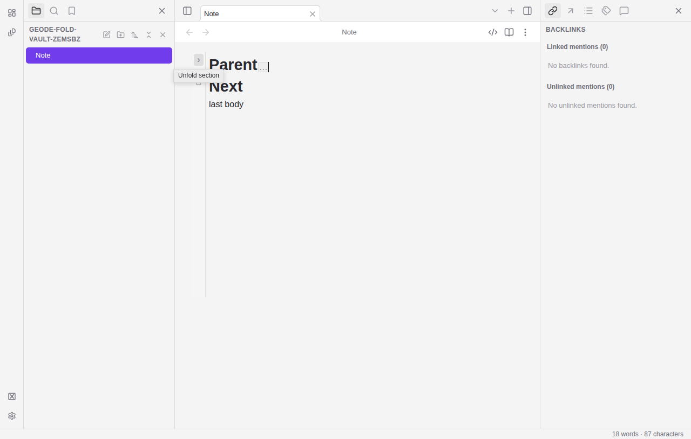
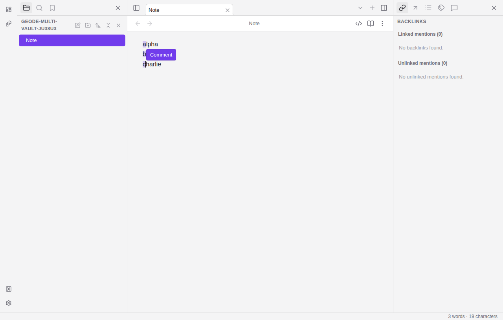

# Editor parity evidence

Captured 2026-10-15 on Linux test-worker-2 in Electron from commit `a47e26d`.
Synthetic throwaway vaults contain only the fixture text from
`tests/e2e/editor-folding-multicursor.spec.ts`. Both captures are 1280 × 815
physical pixels (1× desktop scale). They were inspected
visually after the two real-input Electron tests passed. These show local test
behavior; they are not release verification.

The Parent heading is collapsed while the next top-level heading stays visible.

The rectangle selects the first character on each of three lines. The existing
Comment affordance anchors to the main selection; typing edits all three ranges.
