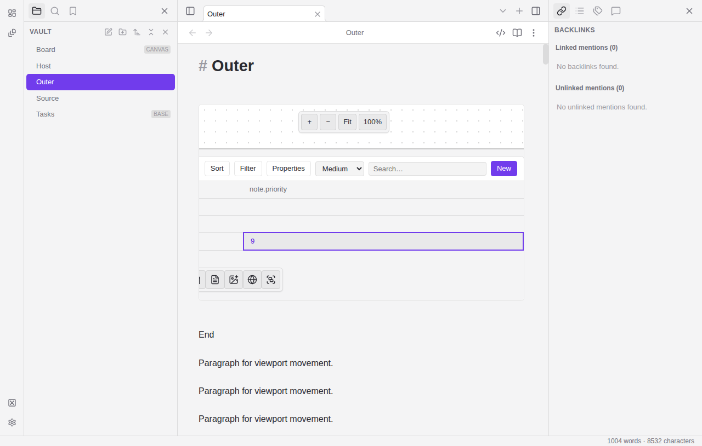
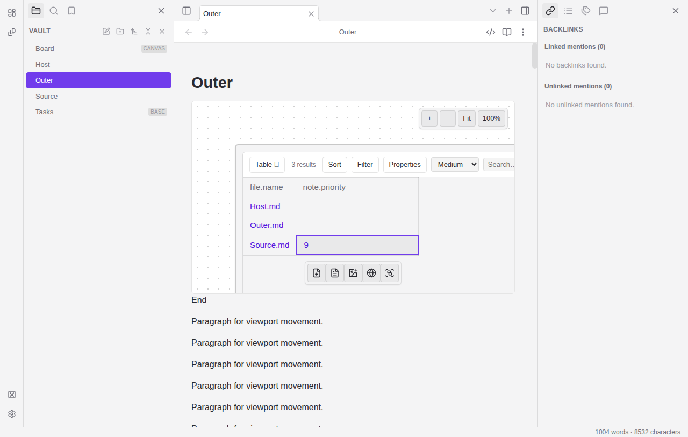
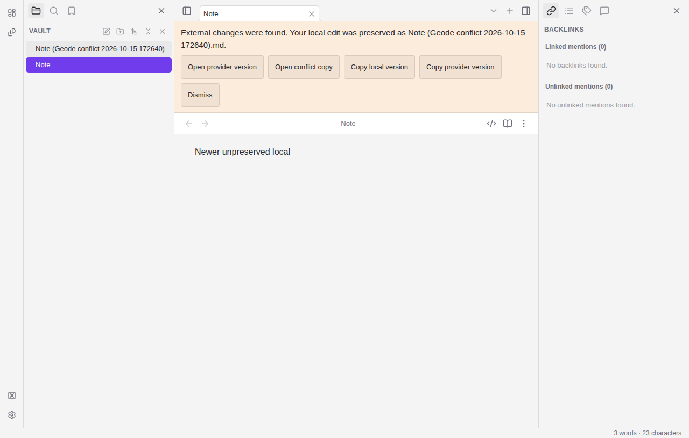

# Native prerequisite runtime captures

Actual Linux Electron captures on test-worker-2, 2026-10-15, 1280×815. Tested source `b53aa3a0ff85a3820044b7a9ffa9b8525f8577b4`; testq `01M50963RMMAA8BZX6Y9CFK7AZ`. Source artifact paths and exact SHA256 values are recorded in [capture-manifest.json](capture-manifest.json). These captures are synthetic runtime fixtures, not personal vault data.

Both runtime case records preserve provider priority2 and the same connected unfinished9 control after the refused replacement; explicit subsequent Enter saves9. These images prove the retained control state at capture, not compact layout parity. Existing nested Base columns/toolbars can remain clipped; compact presentation and production persistent-layer wiring are separate unresolved work.

Recovery controls remain reachable while a newer local buffer is refused close; assertions separately verify the provider and recovery-copy bytes.
