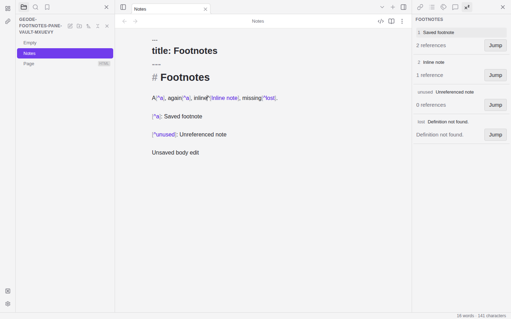
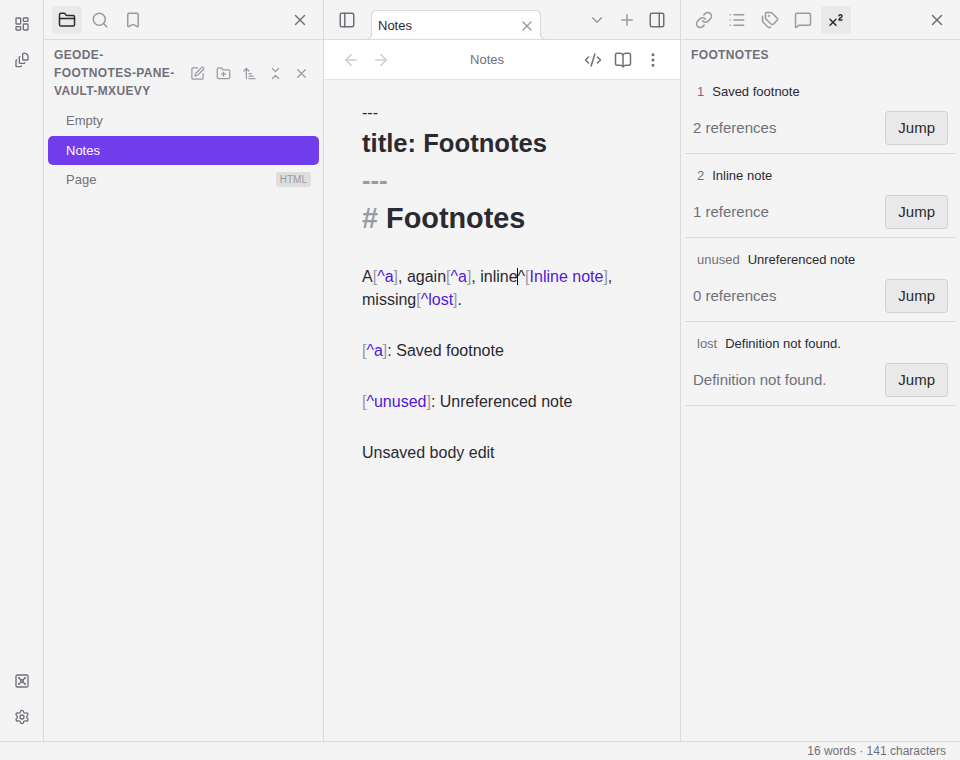

# Footnotes pane

Enable **Footnotes** under **Settings → Core plugins**, then run **Footnotes:
Show footnotes** from the command palette. The pane follows the active Markdown
note and restores with your workspace after restart. Disable Footnotes to remove
its pane and command. If saving the toggle fails, a **Could not update Footnotes**
notice reports the failure; the current session may differ from the last saved
setting until a later successful change.

Each defined or inline footnote appears once. Definitions show their number in
reference order, unreferenced definitions show their authored ID, and repeated
references contribute to the count. A dangling reference has a **Definition not
found** state and a working Jump control.

Click a footnote's text to reveal Source mode and select its current text in the
note's editor. Type to edit, use normal Undo, and let normal autosave persist the
note. The pane refreshes from unsaved editor text. **Jump** navigates to the
footnote's source position. Both controls support keyboard activation. No-note,
empty and read-error states are explicit; read-only files do not offer editing.

The pane currently scans the first 8,192 characters and displays at most 200 rows,
with a visible limited-scan notice when either bound is reached. Definitions cut
by that boundary permit navigation but not selection editing. Definitions outside
that range may appear as not found in the scanned text. This keeps work bounded
while reusing the shared scanner; full large-note coverage remains incomplete.
Frontmatter and code do not contribute footnotes. The chosen editing interaction
is in the note's Source editor; this feature does not add an independent inline
sidebar text editor.

Screenshots from the synthetic Footnotes fixture, captured on Linux with
Electron42.10.0 at tested source commit `31e5deb` on2026-10-15. Both show the
Source editor after a normal footnote edit, including repeated references, an
inline footnote, an unreferenced definition and a missing-definition state. The
1440×900 desktop and960×760 compact captures were visually inspected; controls
remain legible and source text wraps within the editor. They come from the fresh
passing full worker gate, not the earlier historical captures.

