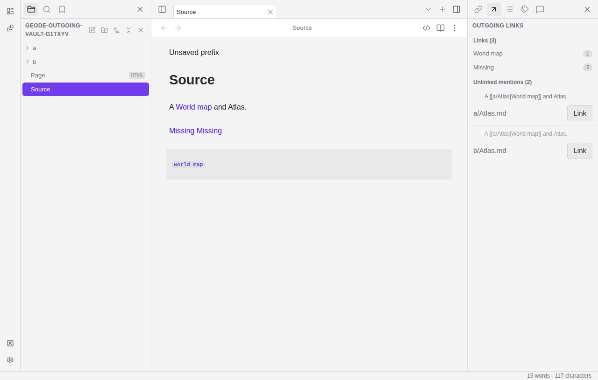
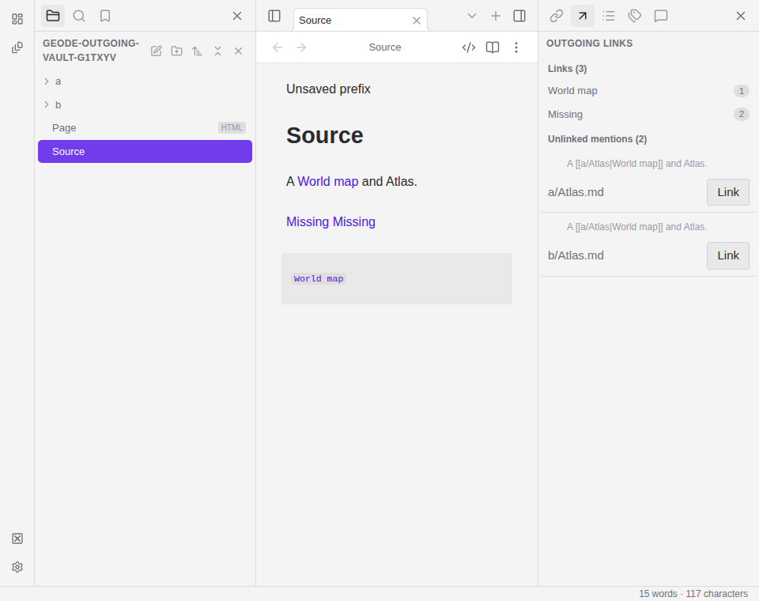

# Outgoing links

Use the **Outgoing links** tab in the right sidebar, or run **Show outgoing links**
from the command palette. The pane follows the active Markdown note.

**Links** shows authored wikilinks, Markdown links/images and reference-style
links in first-appearance order, including
heading/block references and missing targets. Counts combine repeated authored
targets. Activate a target to navigate; Cmd/Ctrl-click opens a new tab. Names have
full-path hover/accessibility labels to disambiguate duplicate filenames.

**Unlinked mentions** finds other Markdown notes named in the current note by
basename or frontmatter alias. Click **Link** to convert one occurrence. Alias
spelling and all surrounding text are preserved. The change uses the current
editor buffer and normal undo/autosave. Stale suggestions refresh without editing.
Read-only/Reading views show suggestions with conversion disabled. To keep the
editor responsive on large or dense notes, mention scans inspect the first 128 Ki
characters and collect at most 500 matches. The pane explicitly announces a
limited scan whenever either bound is reached; its displayed count is then a
subset, not a total. Scans yield within single-target matches and between targets. A mention
inside a code block can be converted, but links inside code do not enter Links.

Under **Settings → Files and links → Excluded files**, list vault-relative files,
folders or `/pattern/` (optionally `/pattern/i`) to hide potential targets. Literal
folder paths match descendants at folder boundaries. Patterns allow character
classes, anchors, and at most one `*` or `+` repetition; groups, alternation,
braces, optional repetition, backreferences and patterns longer than 128 characters
are rejected. Invalid settings preserve the last valid list. Exclusions are saved
per vault on this device and currently affect potential outgoing targets only.
They do not alter indexing, search, existing links or sync scope.

## Current coverage boundaries

Links uses the shared metadata parser, including inline Markdown destinations,
images and full/collapsed/shortcut reference forms with definitions. External URL
schemes are omitted from internal target activation. Code does not contribute
links. The mention limit described above applies to suggestions; Links uses the
shared parser's normal coverage. This integrated parser coverage is tested, but
does not establish complete Outgoing links or linking parity.

## Preview

The screenshots below use a synthetic temporary vault with aliases and duplicate
basenames. Captured 2026-10-15 on Linux test-worker-2 in Electron from source commit
`d53a008` (branch `feat/overnight-outgoing-delivery`), at 1280×815 and 960×760
pixels. They show the real Electron pane after converting an alias from an
unsaved editor buffer; no user vault data is included.

